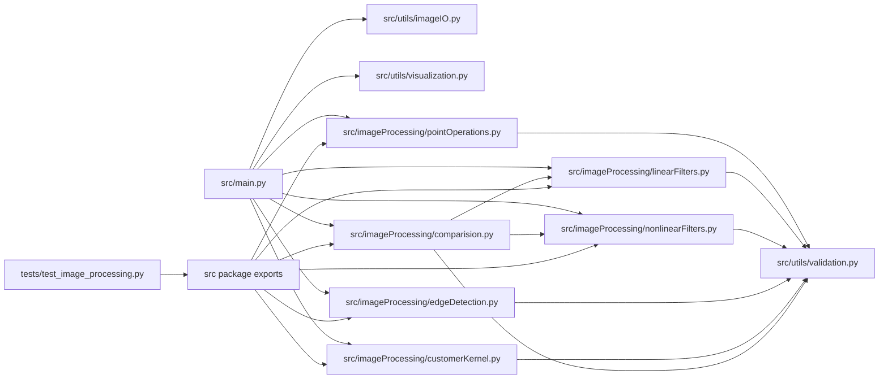
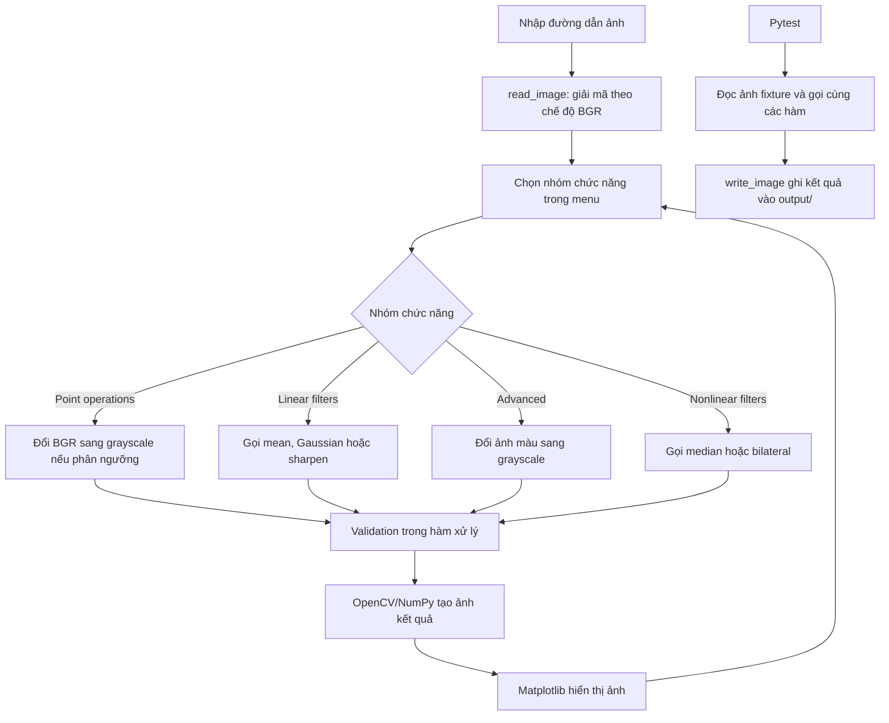

# ALGORITHM – CÁC THUẬT TOÁN XỬ LÝ ẢNH

## Mục lục

- [1. Tổng quan hệ thống](#1-tổng-quan-hệ-thống)
- [2. Kiến trúc chương trình](#2-kiến-trúc-chương-trình)
- [3. Quy trình xử lý ảnh tổng thể](#3-quy-trình-xử-lý-ảnh-tổng-thể)
- [4. Các nhóm thuật toán](#4-chi-tiết-các-nhóm-thuật-toán)
- [5. Đặc tả thuật toán](#5-đặc-tả-từng-thuật-toán)
- [6. Đánh giá thuật toán](#6-đánh-giá-thuật-toán)
- [7. Tổng kết](#7-tổng-kết)

## 1. Tổng quan hệ thống

Lab2 là chương trình Python xử lý ảnh tĩnh bằng NumPy và OpenCV, có giao diện menu dòng lệnh và hiển thị kết quả bằng Matplotlib. Các phép xử lý được cài đặt trong `src/imageProcessing/`; tiện ích đọc/ghi, kiểm tra dữ liệu và trực quan hóa nằm trong `src/utils/`.

Các chức năng có bằng chứng trong source:

- Biến đổi điểm ảnh: điều chỉnh sáng/tương phản, âm bản và phân ngưỡng nhị phân.
- Lọc tuyến tính: Mean, Gaussian, sharpen và lọc bằng kernel định sẵn hoặc kernel tùy chỉnh.
- Lọc phi tuyến: Median và Bilateral.
- Phát hiện biên: Sobel và Prewitt.
- So sánh Mean, Gaussian, Median, Bilateral; tính MSE, MAE, PSNR và thời gian.

Các hàm xử lý ảnh chính nhận `numpy.ndarray` `uint8`. Phần lớn chấp nhận ảnh xám 2D hoặc ảnh màu ba kênh; phân ngưỡng và phát hiện biên yêu cầu ảnh xám. Chương trình chính hiển thị ảnh nhưng không lưu ảnh. Các ảnh trong `output/` được ghi bởi test thông qua `write_image`.

## 2. Kiến trúc chương trình

| Thành phần                                | Vai trò thực tế                                                                                            |
| ----------------------------------------- | ---------------------------------------------------------------------------------------------------------- |
| `src/main.py`                             | Đọc đường dẫn ảnh từ bàn phím, điều phối menu và gọi các hàm xử lý; hiển thị kết quả.                      |
| `src/imageProcessing/pointOperations.py`  | `adjust_brightness_contrast`, `negative_image`, `threshold_image`.                                         |
| `src/imageProcessing/linearFilters.py`    | `mean_filter`, `gaussian_filter`, `sharpen_filter`.                                                        |
| `src/imageProcessing/nonlinearFilters.py` | `median_filter`, `bilateral_filter`.                                                                       |
| `src/imageProcessing/edgeDetection.py`    | `sobel_edge_detection`, `prewitt_edge_detection` và chuẩn hóa độ lớn gradient.                             |
| `src/imageProcessing/customerKernel.py`   | Bốn kernel mẫu và `apply_custom_kernel`.                                                                   |
| `src/imageProcessing/comparision.py`      | `calculate_metrics`, `evaluate_filter_results`, `compare_filters`. Tên file được viết là `comparision.py`. |
| `src/utils/imageIO.py`                    | `read_image`, `write_image`, `get_image_info`; dùng OpenCV và hỗ trợ đường dẫn Unicode trên Windows.       |
| `src/utils/validation.py`                 | Kiểm tra cấu trúc ảnh: NumPy array, không rỗng, `uint8`, số chiều và số kênh.                              |
| `src/utils/validationFilter.py`           | Kiểm tra kích thước/ma trận kernel, kiểu biên và số nguyên không âm.                                       |
| `src/utils/visualization.py`              | Hiển thị ảnh bằng Matplotlib và cung cấp các menu.                                                         |
| `tests/test_image_processing.py`          | Test xử lý ảnh, tạo nhiễu và ghi ảnh kết quả vào `output/`.                                                |
| `data/input/images.jpg`                   | Ảnh đầu vào đang có trong workspace.                                                                       |

`src/__init__.py`, `src/imageProcessing/__init__.py` và `src/utils/__init__.py` tái xuất các hàm để test nhập chúng từ `src`. File `requirement.txt` hiện rỗng; do đó không có danh sách hay phiên bản dependency được khai báo tại đây.



## 3. Quy trình xử lý ảnh tổng thể



Luồng menu trong `main()` hỏi người dùng đường dẫn ảnh rồi gọi `read_image(..., mode="BGR")`. Các hàm kiểm tra dữ liệu trước khi xử lý. Những lỗi `TypeError`, `ValueError` và lỗi OpenCV được bắt ở các nhánh menu và in ra màn hình. `write_image` không nằm trong luồng menu chính; test mới là nơi ghi ảnh đầu ra.

**Sai khác cần lưu ý:** ảnh đọc ở `main()` là BGR, nhưng `run_advanced()` gọi `cv2.cvtColor(image, cv2.COLOR_RGB2GRAY)`. Ngoài ra, `show_result()` mặc định khai báo chế độ `"RGB"` trong khi ảnh màu do menu nhận là BGR. Hai điểm này có thể làm sai mức xám hoặc đảo kênh khi hiển thị; không phải thay đổi của các thuật toán lõi.

## 4. Chi tiết các nhóm thuật toán

### 4.1. Point Operations

`adjust_brightness_contrast` áp dụng một biến đổi tuyến tính lên từng kênh; `negative_image` đảo mức từng kênh; `threshold_image` chỉ nhận ảnh xám và tạo đầu ra nhị phân. Hàm điều chỉnh sáng/tương phản nhận `alpha` (mặc định `1.0`, phải lớn hơn 0) và `beta` (mặc định `0.0`, trong `[-255,255]`). Ngưỡng mặc định của phân ngưỡng là `128`.

### 4.2. Linear Filters

- `mean_filter`: trung bình trên cửa sổ vuông `kernel_size × kernel_size`.
- `gaussian_filter`: gọi `cv2.GaussianBlur`; cho phép `kernel_size=0` khi `sigma>0`, hoặc `sigma=0` để OpenCV tự chọn sigma khi kernel dương.
- `sharpen_filter`: kernel mặc định 3×3 có tâm `5`, bốn láng giềng trực giao `-1`, các góc `0`.
- `apply_preset_kernels`: lần lượt áp dụng Box Blur, Sharpen, Laplacian, Emboss. `apply_custom_kernel` nhận một ma trận kernel do caller cung cấp.

Các hàm lọc tuyến tính giữ nguyên kích thước ảnh và kiểu `uint8`; kiểu biên mặc định là `cv2.BORDER_DEFAULT`. Các kiểu biên được validator dùng chung chấp nhận là `BORDER_CONSTANT`, `BORDER_REPLICATE`, `BORDER_REFLECT`, `BORDER_REFLECT_101`.

### 4.3. Nonlinear Filters

- `median_filter`: gọi `cv2.medianBlur`; cửa sổ mặc định 3×3, xử lý riêng từng kênh màu theo OpenCV.
- `bilateral_filter`: gọi `cv2.bilateralFilter`; mặc định `diameter=9`, `sigma_color=75.0`, `sigma_space=75.0`. `diameter=0` được cho phép để OpenCV tự suy ra đường kính.

`median_filter` kiểm tra kernel là số nguyên lẻ bằng validator dùng chung, nhưng validator mặc định chấp nhận từ 1; docstring của hàm lại mô tả điều kiện lớn hơn 1. Điều kiện cuối cùng còn phụ thuộc giới hạn mà OpenCV áp dụng.

### 4.4. Edge Detection

Hai hàm yêu cầu ảnh xám. Sobel dùng `cv2.Sobel` để lấy đạo hàm X/Y; Prewitt dùng hai ma trận 3×3 cố định với `cv2.filter2D`. Cả hai tính độ lớn gradient, sau đó chuẩn hóa min–max về `uint8` [0,255]. Kích thước Sobel mặc định là 3; Prewitt không nhận kích thước kernel.

### 4.5. Filter Comparison

`compare_filters` chạy Mean, Gaussian, Median và Bilateral độc lập trên cùng ảnh nhiễu. Mỗi hàm lọc được gọi một lần warm-up, rồi gọi `repeat` lần để tính thời gian trung bình bằng `time.perf_counter`; mặc định `repeat=5`. Bộ lọc Mean/Gaussian/Median dùng `kernel_size=5`; Gaussian dùng `sigma=1.0`; Bilateral dùng đường kính 5 và hai sigma 75.

Hàm trả về `(filtered_images, evaluation)`. Mỗi phần tử trong `evaluation` có tên bộ lọc, MSE, MAE, PSNR và thời gian trung bình ms. **Trong chính `compare_filters`, các chỉ số chất lượng được tính giữa ảnh nhiễu đầu vào và ảnh đã lọc, không phải ảnh sạch.** Riêng `run_comparison` trong `main.py` gọi lại `evaluate_filter_results(gray_image, filtered_images)` để tính các chỉ số hiển thị so với ảnh sạch. Test gọi trực tiếp `compare_filters`, nên các số trong test nếu chạy sẽ không đại diện cho sai số so với ảnh sạch.

## 5. Đặc tả từng thuật toán

### 5.1. Điều chỉnh độ sáng và độ tương phản — `adjust_brightness_contrast`

**Mục đích:** biến đổi tuyến tính độ sáng và tương phản trên ảnh xám hoặc ảnh ba kênh.

**Input:** ảnh `uint8`; `alpha=1.0`; `beta=0.0`.

**Output:** ảnh `uint8`, cùng shape và số kênh.

**Các bước xử lý:** xác thực ảnh; kiểm tra `alpha > 0`, `-255 ≤ beta ≤ 255`; chuyển ảnh sang `float32`; tính và giới hạn kết quả trong `[0,255]`; làm tròn bằng `np.rint`, chuyển về `uint8`.

**Pseudocode:**

```text
validate(image)
tmp = alpha * float32(image) + beta
result = uint8(round(clip(tmp, 0, 255)))
return result
```

**Xử lý lỗi:** lỗi kiểu/cấu trúc ảnh từ `validate_image`; `ValueError` nếu alpha hoặc beta ngoài miền. Source không kiểm tra tường minh kiểu số hoặc tính hữu hạn của `alpha`/`beta`.

### 5.2. Ảnh âm bản — `negative_image`

**Mục đích:** đảo mức pixel trên từng kênh.

**Input:** ảnh xám hoặc ba kênh, `uint8`.

**Output:** `255 - image`, cùng shape và kiểu dữ liệu.

**Các bước xử lý:** xác thực ảnh; trừ từng giá trị khỏi 255; trả về kết quả.

**Pseudocode:** `return 255 - image`

**Tham số:** không có tham số điều khiển.

**Xử lý lỗi:** ảnh rỗng, không phải NumPy array/`uint8`, hoặc cấu trúc kênh không hợp lệ sẽ bị validator từ chối.

### 5.3. Phân ngưỡng nhị phân — `threshold_image`

**Mục đích:** chuyển ảnh xám thành ảnh chỉ có hai mức.

**Input:** ảnh xám 2D `uint8`; `threshold=128`, số nguyên trong `[0,255]`.

**Output:** ảnh `uint8` cùng kích thước, chứa 0 hoặc 255.

**Các bước xử lý:** xác thực grayscale; từ chối boolean/giá trị không nguyên; kiểm tra miền ngưỡng; đặt pixel đầu ra bằng 255 nếu pixel đầu vào `>= threshold`, ngược lại bằng 0.

**Pseudocode:**

```text
validate(grayscale_image)
for each pixel:
    output[pixel] = 255 if pixel >= threshold else 0
return output
```

**Xử lý lỗi:** `TypeError` với ngưỡng không nguyên; `ValueError` với ảnh màu hoặc ngưỡng ngoài miền.

### 5.4. Mean Filter — `mean_filter`

**Mục đích:** làm mượt bằng trung bình cộng trong cửa sổ.

**Input:** ảnh xám hoặc ba kênh `uint8`; `kernel_size=3` (số nguyên lẻ dương); `border_type=cv2.BORDER_DEFAULT`.

**Output:** ảnh cùng shape, dtype và số kênh.

**Các bước xử lý:** xác thực ảnh, kích thước kernel, kiểu biên; gọi `cv2.blur` với kernel vuông.

**Pseudocode:** `return cv2.blur(image, (kernel_size, kernel_size), borderType)`

**Xử lý lỗi:** validator báo lỗi kiểu/miền kernel và kiểu biên; lỗi OpenCV được truyền lên caller.

### 5.5. Gaussian Filter — `gaussian_filter`

**Mục đích:** làm mượt bằng kernel Gaussian.

**Input:** ảnh `uint8`; `kernel_size=3`; `sigma=0.0`; `border_type=cv2.BORDER_DEFAULT`. Kernel là số nguyên lẻ dương hoặc 0; sigma phải hữu hạn và không âm.

**Output:** ảnh cùng shape, dtype và số kênh.

**Các bước xử lý:** xác thực ảnh, kernel, kiểu biên, sigma; từ chối cặp `kernel_size=0, sigma=0`; gọi `cv2.GaussianBlur` với `sigmaX=sigma`, `sigmaY=sigma`.

**Pseudocode:**

```text
validate(image, kernel_size, border_type, sigma)
if kernel_size == 0 and sigma == 0: error
return GaussianBlur(image, kernel_size, sigma, border_type)
```

**Xử lý lỗi:** lỗi kiểu/miền được nêu trên; kích thước kernel cụ thể còn chịu ràng buộc OpenCV.

### 5.6. Sharpen Filter — `sharpen_filter`

**Mục đích:** tăng cường chi tiết bằng lọc không gian.

**Input:** ảnh `uint8`; kernel tùy chọn; kiểu biên mặc định `BORDER_DEFAULT`.

**Output:** ảnh cùng shape và `uint8`.

**Các bước xử lý:** nếu không truyền kernel, dùng kernel mặc định có tổng trọng số 1; nếu có, kiểm tra kiểu và ma trận, kiểm tra giá trị hữu hạn, phát `RuntimeWarning` nếu tổng kernel không gần 1; gọi `cv2.filter2D(..., ddepth=-1)`.

**Tham số:** kernel tùy chỉnh là ma trận số hai chiều có kích thước lẻ, mỗi chiều ít nhất 3. `ddepth=-1` giữ độ sâu đầu ra theo ảnh đầu vào; do đó giá trị nằm ngoài miền biểu diễn `uint8` bị bão hòa theo quy tắc của OpenCV.

**Xử lý lỗi:** sai kiểu/shape/kernel không hữu hạn hoặc kiểu biên không được hỗ trợ dẫn đến exception; tổng kernel lệch 1 chỉ phát cảnh báo.

### 5.7. Kernel mẫu và kernel tùy chỉnh — `apply_preset_kernels`, `apply_custom_kernel`

**Mục đích:** áp dụng các ma trận trọng số qua `cv2.filter2D`.

**Input:** ảnh `uint8`; kiểu biên mặc định `BORDER_DEFAULT`; với `apply_custom_kernel`, ma trận kernel do caller cung cấp.

**Output:** `apply_preset_kernels` trả danh sách 4 ảnh theo thứ tự Box Blur, Sharpen, Laplacian, Emboss. `apply_custom_kernel` trả một ảnh cùng shape, kênh và dtype.

**Các bước xử lý:** xác thực ảnh/kiểu biên; kernel tùy chỉnh được chuyển sang `float32` sau khi kiểm tra ma trận hai chiều, số lẻ, số học thực và hữu hạn; lọc từng kernel với `ddepth=-1`.

**Kernel mẫu:** Box Blur có mọi trọng số `1/9`; Sharpen có tâm 5 và bốn láng giềng -1; Laplacian có tâm 4 và bốn láng giềng -1; Emboss dùng ma trận `[-2,-1,0; -1,1,1; 0,1,2]`.

**Xử lý lỗi:** kernel rỗng, không phải NumPy array/ma trận hai chiều, kích thước chẵn, kiểu không số hoặc chứa NaN/Inf sẽ bị từ chối. Trong menu chính, nhánh kernel tùy chỉnh hiện truyền chuỗi nhập từ `input()` trực tiếp cho hàm vốn yêu cầu `numpy.ndarray`; vì vậy đường nhập kernel này không thực hiện được nếu không chuyển đổi dữ liệu.

### 5.8. Median Filter — `median_filter`

**Mục đích:** thay mỗi pixel bằng trung vị của lân cận.

**Input:** ảnh xám hoặc ba kênh `uint8`; `kernel_size=3`.

**Output:** ảnh cùng shape và dtype; OpenCV lọc từng kênh.

**Các bước xử lý:** xác thực ảnh và kích thước kernel lẻ; gọi `cv2.medianBlur`.

**Tham số/xử lý lỗi:** docstring yêu cầu kích thước lẻ lớn hơn 1, nhưng validator dùng chung chỉ cưỡng chế số nguyên lẻ từ 1. Trường hợp `kernel_size=1` và các giới hạn backend chưa được test đầy đủ; lỗi OpenCV có thể phát sinh.

### 5.9. Bilateral Filter — `bilateral_filter`

**Mục đích:** làm mượt có xét khoảng cách không gian và tương đồng cường độ.

**Input:** ảnh xám hoặc ba kênh `uint8`; `diameter=9`; `sigma_color=75.0`; `sigma_space=75.0`; `border_type=BORDER_DEFAULT`.

**Output:** ảnh cùng shape, dtype và số kênh.

**Các bước xử lý:** xác thực ảnh; xác nhận `diameter` là số nguyên không âm; xác thực kiểu biên; gọi `cv2.bilateralFilter`.

**Xử lý lỗi:** `diameter` âm hoặc không nguyên bị từ chối. Source không kiểm tra tường minh miền/độ hữu hạn của hai sigma; các giới hạn đó phụ thuộc OpenCV.

### 5.10. Sobel Edge Detection — `sobel_edge_detection`

**Mục đích:** ước lượng gradient theo X/Y rồi tạo ảnh độ lớn.

**Input:** ảnh xám `uint8`; `kernel_size=3`; `border_type=BORDER_DEFAULT`.

**Output:** ảnh biên 2D `uint8` cùng kích thước.

**Các bước xử lý:** xác thực grayscale, kích thước và kiểu biên; gọi `cv2.Sobel` hai lần với `ddepth=CV_32F`, lần lượt `dx=1,dy=0` và `dx=0,dy=1`; tính độ lớn; chuẩn hóa min–max về `[0,255]`, làm tròn và chuyển `uint8`.

**Xử lý lỗi:** kernel qua validator là số nguyên lẻ dương; các giới hạn Sobel cụ thể còn do OpenCV kiểm tra. Nếu gradient không đổi và bằng 0, hàm trả ảnh đen; nếu gradient không đổi nhưng dương, hàm trả ảnh mức 255.

### 5.11. Prewitt Edge Detection — `prewitt_edge_detection`

**Mục đích:** tính gradient bằng hai kernel Prewitt 3×3 cố định.

**Input:** ảnh xám `uint8`; `border_type=BORDER_DEFAULT`.

**Output:** ảnh biên 2D `uint8` cùng kích thước.

**Các bước xử lý:** xác thực ảnh và kiểu biên; tạo kernel X `[-1,0,1; -1,0,1; -1,0,1]`, kernel Y `[-1,-1,-1; 0,0,0; 1,1,1]`; lọc với `cv2.filter2D`, `CV_32F`; tính và chuẩn hóa độ lớn gradient như Sobel.

**Xử lý lỗi:** ảnh màu bị từ chối; kiểu biên không hợp lệ bị validator từ chối.

### 5.12. Đánh giá và so sánh — `calculate_metrics`, `evaluate_filter_results`, `compare_filters`

**Mục đích:** tính sai số giữa hai ảnh, tổng hợp nhiều kết quả và đo thời gian bốn bộ lọc.

**Input:** ảnh `uint8` cùng shape; `compare_filters` có các tham số mặc định nêu tại mục 4.5 và `repeat=5`.

**Output:** `calculate_metrics` trả dict `MSE`, `MAE`, `PSNR` dạng float. `evaluate_filter_results` trả list dict có tên bộ lọc và ba chỉ số. `compare_filters` trả list ảnh và list dict có thêm `Execution Time (ms)`.

**Các bước xử lý:** xác thực ảnh và shape; chuyển hai ảnh sang `float64`; tính sai số trên mọi phần tử/kênh; PSNR là vô cực nếu MSE bằng 0. Khi benchmark, chạy warm-up rồi đo `repeat` lần cho mỗi bộ lọc bằng `perf_counter`.

**Pseudocode:**

```text
for filter in [Mean, Gaussian, Median, Bilateral]:
    filter(noisy_image)                  # warm-up
    start = perf_counter()
    repeat times: result = filter(noisy_image)
    elapsed_ms = (perf_counter() - start) * 1000 / repeat
    save result and elapsed_ms
metrics = evaluate_filter_results(noisy_image, results)
return results, metrics
```

**Xử lý lỗi:** ảnh sai kiểu/cấu trúc hoặc khác shape bị từ chối; `repeat` phải là số nguyên dương. `evaluate_filter_results` yêu cầu `filtered_images` là list và số phần tử khớp số tên.

### 5.13. Tạo nhiễu trong test

Hai helper nằm trong `tests/test_image_processing.py`, không phải API của `src`:

- `create_salt_pepper_noise(image, amount=0.05)` sao chép ảnh, chọn `floor(N×amount)` chỉ số phẳng không lặp bằng RNG seed 42, rồi gán ngẫu nhiên các giá trị 0/255 với xác suất chia đôi.
- `create_gaussian_noise(image, sigma=20.0)` sinh nhiễu chuẩn `N(0,sigma²)` bằng seed 42, cộng vào ảnh `float32`, clip `[0,255]` rồi ép `uint8`.

Test tạo cả hai ảnh nhiễu từ cùng ảnh xám gốc và gọi `compare_filters(..., repeat=3)` cho mỗi ảnh.

### 5.14. I/O, validation và visualization

- `read_image(path, mode="BGR") -> np.ndarray`: đọc các định dạng JPG/JPEG, PNG, BMP, WEBP, TIF/TIFF; hỗ trợ BGR, RGB, GRAY, UNCHANGED và bí danh GRAYSCALE. Đọc/giải mã lỗi sẽ phát `FileNotFoundError`, `ValueError` hoặc `OSError`.
- `write_image(path, img, color_order="AUTO", create_dirs=True, params=None) -> Path`: nhận ảnh `uint8`/`uint16` 2D, ảnh 3 kênh BGR/RGB hoặc ảnh 4 kênh BGRA/RGBA; mã hóa theo phần mở rộng được hỗ trợ và trả đường dẫn lưu. Có thể tạo thư mục cha; lỗi dữ liệu, thư mục, mã hóa được nêu thành exception.
- `get_image_info(img) -> dict`: trả `width`, `height`, `channels`, `dtype`; ảnh sai kiểu hoặc rỗng bị từ chối.
- `validate_image(image, grayscale_only=False, allowed_channels=(3,))`: chỉ chấp nhận NumPy array không rỗng `uint8`; ảnh xám 2D luôn hợp lệ, còn ảnh màu phải có số kênh được cho phép.
- `validate_kernel_size(...)`: kiểm tra số nguyên, miền và tính lẻ; có tùy chọn `allow_zero`, `min_size`, `max_size`.
- `validate_kernel_matrix(kernel, min_size=1)`: kiểm tra ma trận số 2D, mỗi chiều lẻ, kích thước tối thiểu và giá trị hữu hạn; trả về `float32`.
- `validate_border_type(border_type)`: chấp nhận `BORDER_CONSTANT`, `BORDER_REPLICATE`, `BORDER_REFLECT`, `BORDER_REFLECT_101`.
- `validate_non_negative_int(value, name="value")`: kiểm tra số nguyên không âm; được dùng cho số lần lặp benchmark.
- `display_images(images, title="Kết quả xử lý ảnh", columns=3) -> None`: nhận dict tên ảnh thành `(ndarray, color_mode)`, hiển thị grayscale hoặc ảnh ba kênh BGR/RGB. Ảnh bốn kênh không được hàm trực quan hóa này hỗ trợ.

## 6. Đánh giá thuật toán

Source hỗ trợ MSE, MAE, PSNR và thời gian trung bình. Công thức và cách diễn giải nằm trong [theory.md](./theory.md); bảng số đo có/không có được ghi riêng trong [experimentLog.md](./experimentLog.md). Các ảnh kết quả có sẵn không kèm file số liệu benchmark. Không thể kết luận bộ lọc nào tốt hơn chỉ từ các ảnh tồn tại hoặc từ test collection.

## 7. Tổng kết

Project hiện thực các phép biến đổi điểm ảnh, bộ lọc không gian, phát hiện biên và đánh giá so sánh. Hàm xử lý chủ yếu dùng OpenCV; quy tắc tham số, định dạng dữ liệu và những khác biệt so với luồng CLI được mô tả ở các mục trên.

## 8. Known Issues and Limitations

- `INPUT_PATH` trỏ đến `data/input/lena.png`, trong khi ảnh hiện có là `data/input/images.jpg`; `main()` vẫn hỏi người dùng nhập đường dẫn ảnh.
- `main()` đọc ảnh ở BGR nhưng `run_advanced()` dùng `cv2.COLOR_RGB2GRAY`; `show_result()` mặc định diễn giải ảnh màu là RGB. Đây là sai khác thứ tự kênh ở luồng CLI.
- Nhánh nhập custom kernel truyền chuỗi trực tiếp vào `apply_custom_kernel`, trong khi API yêu cầu `numpy.ndarray`.
- `compare_filters` tính metric theo ảnh nhiễu đầu vào; `run_comparison` mới đánh giá thêm theo ảnh sạch. Không được coi hai kiểu tham chiếu là tương đương.
- `median_filter` docstring mô tả kernel lẻ lớn hơn 1, còn validator chung chấp nhận 1; các giới hạn backend chưa được kiểm thử đầy đủ.
- `bilateral_filter` kiểm tra kiểu và tính không âm của `diameter`, nhưng không kiểm tra tường minh sigma hữu hạn hoặc miền dương.
- `adjust_brightness_contrast` kiểm tra miền alpha/beta nhưng không kiểm tra tường minh kiểu số hoặc tính hữu hạn.
- `requirement.txt` rỗng; phiên bản dependency chưa được khóa.
- Test dùng đường dẫn tuyệt đối cục bộ và ghi ảnh vào `output/`; việc chạy test trong workspace có thể không portable và có thể ghi đè artifact.
