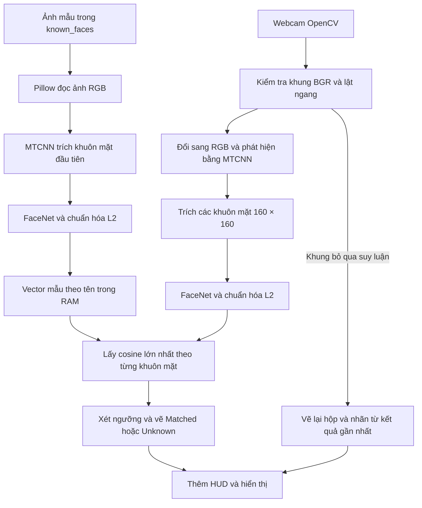
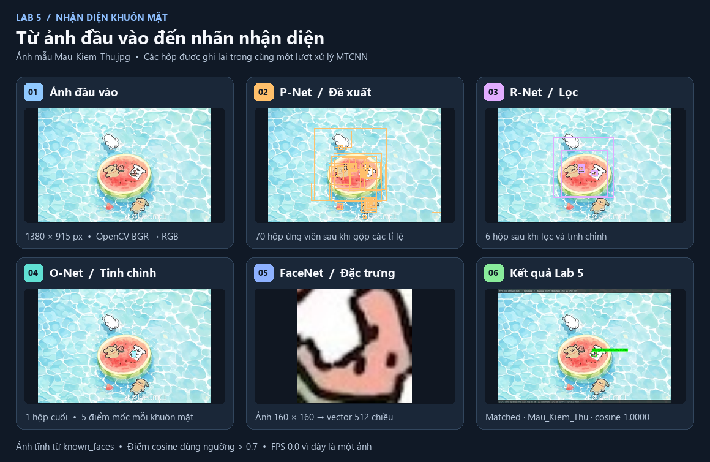

# Luồng dữ liệu nhận diện khuôn mặt trong Lab 5

Lab 5 tạo nhãn trên video bằng cách so sánh khuôn mặt trong khung hình webcam với các khuôn mặt mẫu đã đăng ký. Ảnh mẫu nằm trên đĩa, còn các vector đặc trưng dùng để đối sánh được tạo khi chương trình khởi động và giữ trong bộ nhớ. Hai nhánh gặp nhau tại bước tính độ tương đồng.

Đọc sơ đồ theo hai nhánh. Ở nhánh ảnh mẫu, chương trình chuyển mỗi ảnh hợp lệ thành một vector có tên. Ở nhánh webcam, chương trình chuyển mỗi khuôn mặt phát hiện được thành một vector truy vấn. Điểm cao nhất giữa vector truy vấn và tất cả vector mẫu quyết định nhãn trên khung hình.

## 1. Khởi động và nạp cấu hình

1. `python Lab5.py` gọi `main()`, đọc tham số rồi chuyển chúng cho `run_webcam()`. Cấu hình mặc định gồm camera `0`, thư mục `known_faces/` ở gốc Lab 5, ngưỡng `0.7` và `frame_skip=2`.
2. Với `--config`, chương trình đọc bảng `[recognition]` từ tệp TOML được chỉ định. Các cờ dòng lệnh ghi đè giá trị trong TOML. Giá trị còn thiếu dùng mặc định của `run_webcam()`. Đường dẫn `db_dir` tương đối trong TOML lấy thư mục chứa tệp TOML làm gốc. Đường dẫn tương đối truyền qua `--db-dir` được dùng theo thư mục làm việc.
3. `FaceRecognitionSystem` chọn thiết bị đã truyền qua `device`. Ở chế độ tự động, hệ thống dùng `cuda:0` khi PyTorch báo CUDA khả dụng và dùng CPU trong các trường hợp còn lại.
4. Hệ thống khởi tạo MTCNN và FaceNet `InceptionResnetV1` với trọng số `vggface2`, chuyển FaceNet sang chế độ suy luận `eval()` và nạp ảnh mẫu. Camera được mở sau các bước này.

[Điểm vào Lab5.py](../Lab5.py), [tham số dòng lệnh](../src/facelab/cli.py#L181), [đọc TOML](../src/facelab/config.py#L9), [cấu hình mẫu](../configs/default.toml), [khởi tạo mô hình](../src/facelab/core/recognition.py#L25).

## 2. Nhánh ảnh mẫu trên đĩa

1. `load_database()` xóa các vector mẫu đang có trong bộ nhớ và quét trực tiếp thư mục ảnh mẫu. Nếu thư mục chưa tồn tại, chương trình tạo thư mục rồi trả về cơ sở mẫu rỗng. Các phần mở rộng được xét là `.jpg`, `.jpeg`, `.png`, `.bmp` và `.webp`.
2. Tên người lấy từ tên tệp bỏ phần mở rộng. Nếu phần sau dấu gạch dưới cuối cùng chỉ gồm chữ số, chương trình bỏ phần đó. Ví dụ, `Lan.jpg` và `Lan_2.jpg` cùng thêm mẫu vào nhóm `Lan`.
3. Pillow mở ảnh và chuyển sang RGB. MTCNN phát hiện và trích khuôn mặt thành tensor. Nếu tệp có nhiều khuôn mặt, chương trình giữ tensor khuôn mặt đầu tiên MTCNN trả về. Tệp lỗi hoặc ảnh thiếu khuôn mặt hợp lệ được ghi thông báo và bỏ qua.
4. Tensor của một khuôn mặt có dạng `[1, 3, 160, 160]` trước khi vào FaceNet. Trục đầu là số khuôn mặt trong lô, trục thứ hai là ba kênh RGB. FaceNet tạo tensor `[1, 512]`. `F.normalize(..., p=2, dim=1)` chuẩn hóa L2 theo 512 thành phần của mỗi vector. Chương trình chạy bước này trong `torch.no_grad()`.
5. Mỗi vector được chuyển về CPU và thêm vào danh sách ứng với tên người, theo cấu trúc `{tên: [embedding_1, embedding_2, ...]}`. Một người có thể có nhiều ảnh mẫu. Số ảnh nạp thành công và số người được đếm riêng.

Ảnh JPEG hay PNG là dữ liệu lưu lâu dài. Từ điển vector mẫu tồn tại trong phiên nhận diện, được tạo lại khi khởi động hoặc khi nhấn `R`. [Nạp dữ liệu mẫu](../src/facelab/core/recognition.py#L66).

## 3. Nhánh webcam và kiểm tra tín hiệu

Trong chế độ nhận diện, `run_webcam()` yêu cầu độ phân giải `640 × 480` và in kích thước mà camera báo sau khi mở. Trên Windows, `WebcamCapture` thử lần lượt DirectShow mặc định, DirectShow với MJPG, Media Foundation và `CAP_ANY`. Trên hệ điều hành khác, danh sách gồm `CAP_ANY`.

- Khi mở được một chế độ, chương trình gọi `read()` năm lần và chọn khung cuối cùng trong số các khung đúng định dạng để kiểm tra. Khung đúng định dạng là mảng NumPy `uint8` có dữ liệu và dạng `[H, W, 3]` theo thứ tự kênh BGR. Chế độ bị bỏ qua nếu thiếu khung đúng định dạng hoặc khung được chọn có màu xanh lá gần như đồng nhất.
- Phép kiểm tra màu xanh lấy trung bình và độ lệch chuẩn không gian của từng kênh. Khung bị đánh dấu nếu cả ba độ lệch chuẩn dưới `3`, trung bình kênh G trên `100` và trung bình của từng kênh B, R dưới `15`.
- Khi đang chạy, mỗi lần đọc được kiểm tra lại. Sau tối đa ba lần đọc thất bại, chương trình giải phóng chế độ hiện tại rồi thử các chế độ tiếp theo trong danh sách. Lỗi `cv2.error` trong lúc đọc có thể kích hoạt chuyển chế độ sớm hơn. Khi đã thử hết danh sách, `read()` trả `(False, None)` và vòng lặp nhận diện kết thúc. Mỗi lần mở thành công một chế độ, bộ đếm `generation` tăng để vòng lặp nhận diện buộc xử lý khung hợp lệ tiếp theo.
- Khung hợp lệ được lật ngang bằng `cv2.flip(frame, 1)` để người dùng nhìn thấy ảnh như trong gương. Việc phát hiện, vẽ khung và đăng ký từ cửa sổ nhận diện đều dùng hệ tọa độ của ảnh đã lật.

[Mở và phục hồi webcam](../src/facelab/backends.py#L25), [vòng lặp webcam](../src/facelab/cli.py#L29).

## 4. Từ khung hình đến vector truy vấn

| Bước | Dữ liệu đầu ra | Cách chương trình dùng dữ liệu |
| --- | --- | --- |
| Chuẩn bị ảnh | Một bản sao BGR để vẽ và một ảnh Pillow RGB để phân tích | `cv2.cvtColor` đổi thứ tự kênh từ BGR sang RGB trước khi tạo ảnh Pillow. |
| Phát hiện bằng MTCNN | Hộp bao, độ tin cậy và 5 điểm mốc cho mỗi khuôn mặt | `detect(..., landmarks=True)` lấy tọa độ hai mắt, mũi và hai khóe miệng. Ba mạng P-Net, R-Net và O-Net trong MTCNN lần lượt đề xuất vùng, lọc vùng và tinh chỉnh kết quả. |
| Trích khuôn mặt | Tensor `[N, 3, 160, 160]` với `N` khuôn mặt trích được | `extract()` cắt theo các hộp bao, dùng lề cấu hình `20`, đổi kích thước và hậu xử lý tensor. Nếu kết quả có dạng `[3, 160, 160]`, chương trình thêm trục lô. |
| Tạo vector đặc trưng | Tensor `[N, 512]` | FaceNet nhận cả lô trên thiết bị đã chọn. Chương trình chuẩn hóa L2 mỗi hàng trong `torch.no_grad()`. |
| Chọn kết quả để đối sánh | Vector `[1, 512]` cho từng hộp đạt điều kiện | Sau khi tính embedding cho lô, chương trình bỏ qua hộp có độ tin cậy MTCNN dưới `0.6`. Hộp có độ tin cậy đúng `0.6` được xét tiếp. |

Độ tin cậy MTCNN cho biết mức tin cậy của bước **phát hiện khuôn mặt**. Điểm cosine ở bước tiếp theo đo **độ tương đồng giữa hai vector khuôn mặt**. Tọa độ điểm mốc phục vụ việc vẽ khi bật `L`. Khi thiếu hộp bao, khi `extract()` gặp ngoại lệ hoặc trả về `None`, bước xử lý trả về bản sao khung và danh sách kết quả rỗng. [Cấu hình mô hình](../src/facelab/core/recognition.py#L43), [xử lý khung hình](../src/facelab/core/recognition.py#L210).

### Quan sát từng tầng trên một lần chạy

Ảnh trên được xuất từ cửa sổ chẩn đoán dựng riêng khi chạy mã nhận diện Lab 5 trên `known_faces/Mau_Kiem_Thu.jpg`. Các ô dùng cùng một ảnh đầu vào. P-Net giữ **70 hộp ứng viên** sau khi gộp kết quả từ các tỉ lệ. R-Net lọc và tinh chỉnh còn **6 hộp**. O-Net giữ **1 hộp** và trả **5 điểm mốc**. Ảnh cắt `160 × 160` trong ô FaceNet minh họa tensor đầu vào của bước tạo vector 512 chiều. Ô cuối hiển thị ảnh đã vẽ nhãn và HUD bằng mã của Lab 5.

Mẫu này là ảnh minh họa có sẵn trong thư mục đăng ký, nên phép đối sánh gặp lại chính mẫu đó và hiển thị cosine `1.0000`. Số hộp thay đổi theo ảnh đầu vào. Ví dụ minh họa cách dữ liệu đi qua từng tầng và cho thấy MTCNN có thể chọn một vùng trông giống khuôn mặt ngay cả trong hình vẽ.

## 5. Từ điểm cosine đến nhãn

Với mỗi khuôn mặt webcam đủ độ tin cậy phát hiện, `compute_similarity()` chuyển embedding truy vấn về CPU. Hàm duyệt từng vector mẫu của từng người và tính `torch.sum(embedding * known_emb)`. Vì hai vector đã chuẩn hóa L2, tổng tích theo 512 thành phần chính là cosine giữa hai vector. Chương trình giữ mẫu đạt điểm cao nhất trong toàn bộ cơ sở mẫu. Khi hai mẫu có cùng điểm cao nhất đã ghi nhận, mẫu gặp trước được giữ vì bước cập nhật dùng phép so sánh `>`.

- Điểm cao nhất **lớn hơn** ngưỡng cho nhãn `Matched` và tên của mẫu có điểm cao nhất.
- Điểm cao nhất **bằng hoặc nhỏ hơn** ngưỡng cho nhãn `Unknown`. Kết quả vẫn giữ điểm cao nhất để hiển thị.
- Cơ sở mẫu rỗng cho kết quả `Unknown` với điểm `0.0` đối với khuôn mặt đã qua bước phát hiện. Một khung hình có danh sách phát hiện rỗng sẽ chỉ hiển thị video và HUD.

Ví dụ dưới đây dùng các điểm giả định và ngưỡng mặc định `0.7`.

| Điểm của từng mẫu | Điểm cao nhất | Nhãn hiển thị |
| --- | ---: | --- |
| Lan 0.62, Lan 0.83, Minh 0.77 | 0.83 | `Matched: Lan (0.83)` |
| Lan 0.70, Minh 0.68 | 0.70 | `Unknown (0.70)` |
| Lan 0.59, Minh 0.66 | 0.66 | `Unknown (0.66)` |
| Lan 0.704, Minh 0.65 | 0.704 | `Matched: Lan (0.70)` |

Phép so sánh dùng điểm gốc. Nhãn trên video hiển thị điểm đã định dạng tới hai chữ số thập phân, nên `0.704` có thể xuất hiện dưới dạng `0.70` với nhãn `Matched`. [Hàm đối sánh](../src/facelab/core/recognition.py#L176), [định dạng nhãn](../src/facelab/core/recognition.py#L273).

## 6. Từ kết quả đến cửa sổ nhận diện

`process_frame()` trả về ảnh BGR đã vẽ và danh sách `detections`. Mỗi phần tử chứa `box` gồm bốn tọa độ nguyên, `prob` của MTCNN, `status`, `name` và `similarity`. Tọa độ hộp được giới hạn theo biên ảnh trước khi vẽ. Hộp `Matched` có màu xanh lá `(0, 255, 0)` và hộp `Unknown` có màu đỏ `(0, 0, 255)` theo thứ tự BGR. Các điểm mốc được vẽ khi tùy chọn hiển thị đang bật và kết quả có tọa độ điểm mốc.

Với `frame_skip=2`, các khung số 2, 4, 6 và tiếp theo chạy suy luận. Giữa các lượt đó, chương trình vẽ lại hộp và nhãn từ `last_detections` lên ảnh camera mới. Khung đầu tiên có bộ nhớ đệm rỗng. Khi người di chuyển giữa hai lượt, hộp có thể chậm hơn vị trí hiện tại. Điểm mốc chỉ xuất hiện trên khung chạy suy luận vì dữ liệu dùng để vẽ lại gồm hộp và nhãn. Phím `F` bật hoặc tắt cơ chế bỏ qua khung, còn một lần đổi chế độ camera luôn buộc suy luận ngay trên khung hợp lệ tiếp theo.

HUD dùng số kết quả trong `last_detections` để đếm khuôn mặt, `len(database)` để đếm số người có mẫu, ngưỡng đối sánh và trạng thái bỏ qua khung. FPS là tốc độ vòng lặp đọc và hiển thị, cập nhật theo số khung đã đọc trong khoảng đo từ một giây trở lên. Ảnh cuối được đưa vào `cv2.imshow()`. Các nhãn và vector được dùng trong phiên, còn tệp ảnh mẫu được ghi khi đăng ký. Nhấn `Q`, `Esc` hoặc ngắt bằng `Ctrl+C` trong vòng lặp sẽ đưa chương trình tới bước giải phóng camera và đóng cửa sổ. [Vòng lặp và phím điều khiển](../src/facelab/cli.py#L82), [vẽ hộp và HUD](../src/facelab/imaging/overlay.py#L9).

## 7. Đăng ký ảnh mới và thời điểm ảnh có hiệu lực

| Cách đăng ký | Xử lý ảnh | Dữ liệu sau khi thành công |
| --- | --- | --- |
| `python register_face.py --name Lan --image anh.jpg` | MTCNN trên CPU phát hiện hộp đầu tiên. Độ tin cậy dưới `0.7` tạo cảnh báo. Vùng cắt mở rộng `15%` chiều rộng và chiều cao về mỗi phía, có giới hạn theo biên ảnh. | JPEG trên đĩa. Phiên nhận diện đọc ảnh ở lần nạp cơ sở mẫu tiếp theo. |
| `python register_face.py --name Lan` | Cửa sổ đăng ký lật khung ngang và dùng MTCNN trên CPU. Nhấn `Space` hoặc `C` để lưu khi độ tin cậy của hộp đầu tiên lớn hơn `0.8`. Lề cắt cũng là `15%` mỗi phía. | JPEG trên đĩa. Phiên nhận diện đọc ảnh ở lần nạp cơ sở mẫu tiếp theo. |
| Nhấn `S` hoặc `C` trong cửa sổ nhận diện | Nhập tên ở terminal. Chương trình lấy khung BGR hiện tại trước khi vẽ và dùng hộp đầu tiên từ lượt suy luận gần nhất nếu có, mở rộng `10%` mỗi phía. Nếu danh sách kết quả rỗng, MTCNN nhận cả ảnh. Khuôn mặt đầu tiên trích được đi qua FaceNet và chuẩn hóa L2. | JPEG của vùng ảnh đã chọn và vector mới trong bộ nhớ. Các lượt suy luận tiếp theo trong cùng phiên có thể dùng vector ngay. |

Tên lưu được cắt khoảng trắng ở hai đầu và đổi dấu cách thành dấu gạch dưới. Các chế độ ghi JPEG chất lượng `95`, thử `Tên.jpg` trước rồi tăng hậu tố `_1`, `_2` khi trùng. Đăng ký ngay trong cửa sổ nhận diện tính vector trước khi lưu JPEG. Lần nạp lại sẽ đọc JPEG từ đĩa và tính lại vector từ ảnh đã lưu. Nếu nhấn đăng ký đúng khung bị bỏ qua suy luận, hộp lấy từ bộ nhớ đệm có thể lệch so với vị trí khuôn mặt trên ảnh đang lưu.

Phím `R` xây dựng lại cơ sở mẫu trong bộ nhớ từ ảnh trên đĩa. Nhãn trong bộ nhớ đệm của video được làm mới ở lượt suy luận kế tiếp. [Đăng ký độc lập](../src/facelab/datasets/registration.py#L13), [đăng ký trong phiên](../src/facelab/core/recognition.py#L120), [xử lý phím đăng ký và nạp lại](../src/facelab/cli.py#L143).
